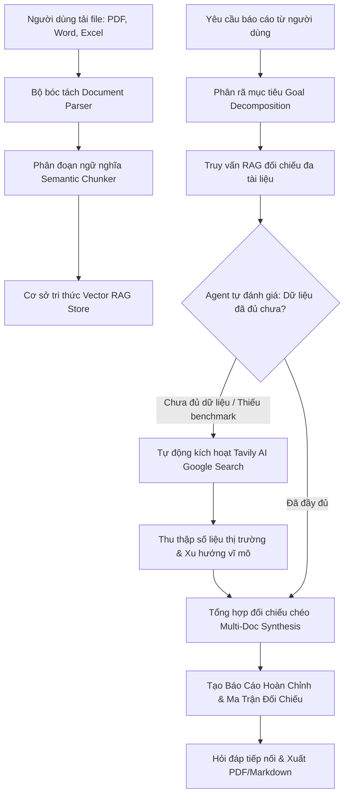

# AutoIntellect AI: Autonomous Document Synthesis & Research Agent

> **Topic:** Building Autonomous & Intelligent AI Systems  
> **Kiến trúc:** Multi-Document Vector RAG + Self-Reflection (Sufficiency Check) + Autonomous Tavily Google Search + Gemini 2.5 + React (Next.js App Router & TypeScript)

---

## 🌟 Giới Thiệu Dự Án

**AutoIntellect AI** là một hệ thống Trí tuệ Nhân tạo Tự hành (Autonomous AI System) được xây dựng nhằm giải quyết bài toán phân tích, đối chiếu chéo số liệu giữa các tệp báo cáo đa định dạng (**PDF**, **Word .docx**, **Excel .xlsx/.xls/.csv**).

Hệ thống sở hữu cơ chế **Tự phản tư & Tự đánh giá tính đầy đủ (Self-Reflection & Sufficiency Check)**:
1. Khi người dùng đưa ra yêu cầu lập báo cáo, hệ thống lập chỉ mục **Vector RAG** trên toàn bộ tài liệu nội bộ.
2. AI Agent phân rã yêu cầu thành các câu hỏi đa chiều và truy xuất ngữ cảnh nội bộ.
3. Agent tự đánh giá: *Dữ liệu trong các tệp nội bộ đã đủ để trả lời câu hỏi và lập báo cáo chuyên sâu chưa? Có thiếu số liệu benchmark ngành, đối thủ cạnh tranh hoặc xu hướng thị trường không?*
4. **Nếu thiếu dữ liệu:** Agent tự động kích hoạt **Tavily AI Search API** để tìm kiếm Google, thu thập số liệu thị trường bên ngoài và tích hợp vào ngữ cảnh.
5. **Tổng hợp báo cáo cấp cao:** Tạo ra bản báo cáo điều hành hoàn chỉnh với bảng so sánh đối chiếu đa tài liệu (Comparative Matrix), phân tích rủi ro, khuyến nghị chiến lược và trích dẫn nguồn minh bạch (Source Attribution).

---

## 🛠️ Công Nghệ Sử Dụng

- **Frontend & Giao diện:** React 19, Next.js 16 (App Router), Tailwind CSS v4, Lucide Icons, React-Markdown, Remark-GFM.
- **Xử lý tài liệu đa định dạng:**
  - `pdf-parse`: Bóc tách văn bản, số trang và từng trang PDF.
  - `mammoth`: Đọc cấu trúc tài liệu Word (`.docx`).
  - `xlsx` (SheetJS): Đọc từng sheet, cột và bảng tính Excel (`.xlsx`, `.xls`, `.csv`).
- **Vector RAG Engine:** Bộ nhớ vector in-memory với thuật toán lai (Hybrid Fusion): Cosine Similarity + BM25/TF-IDF tokenization tiếng Việt & tiếng Anh.
- **Mô hình AI & LLM:** Google Gemini API (`gemini-2.5-flash`, `gemini-1.5-flash`, `gemini-1.5-pro`).
- **Công cụ Tìm kiếm Trực tuyến:** Tavily AI Search API (chuyên dụng cho AI Agents).

---

## 🚀 Hướng Dẫn Cài Đặt & Chạy Dự Án

### 1. Yêu cầu hệ thống
- Node.js version 18 trở lên (Khuyến nghị Node.js v20+ hoặc v24+).
- Trình quản lý gói `npm`.

### 2. Cài đặt dependencies
```bash
npm install
```

### 3. Chạy môi trường phát triển (Development)
```bash
npm run dev
```
Mở trình duyệt tại: [http://localhost:3000](http://localhost:3000)

### 4. Cấu hình API Keys (Tùy chọn)
- Trên giao diện web, bấm nút **"Cấu hình API Keys"** ở góc trên bên phải.
- Nhập **Google Gemini API Key** (lấy miễn phí tại [Google AI Studio](https://aistudio.google.com/app/apikey)).
- Nhập **Tavily API Key** (đăng ký 1.000 lượt tìm kiếm miễn phí tại [tavily.com](https://tavily.com)).
- *(Lưu ý: Hệ thống có tích hợp sẵn chế độ mô phỏng thông minh và bộ dữ liệu mẫu 3 tệp PDF + Excel + Word để trải nghiệm ngay lập tức mà không bắt buộc phải nhập key)*.

---

## 📋 Luồng Hoạt Động Của Autonomous Agent



---

## 📂 Cấu Trúc Thư Mục Dự Án

```
├── src/
│   ├── app/
│   │   ├── api/
│   │   │   ├── agent/
│   │   │   │   ├── chat/route.ts            # API hỏi đáp tiếp nối về báo cáo
│   │   │   │   ├── generate-report/route.ts # API điều phối Autonomous Agent
│   │   │   │   └── sample-data/route.ts     # API cung cấp bộ dữ liệu mẫu 3 định dạng
│   │   │   └── documents/
│   │   │       └── upload/route.ts          # API bóc tách tệp PDF, Word, Excel
│   │   ├── globals.css                      # Giao diện Dark theme, glassmorphism & print style
│   │   ├── layout.tsx                       # Layout & SEO metadata
│   │   └── page.tsx                         # Dashboard ứng dụng chính
│   ├── components/
│   │   ├── Header.tsx                       # Thanh tiêu đề, nút nạp dữ liệu mẫu & API status
│   │   ├── DocumentUploader.tsx             # Vùng tải tệp, badge định dạng & xem chunks
│   │   ├── AgentControlPanel.tsx            # Bảng điều khiển yêu cầu, mẫu prompt & toggle Tavily
│   │   ├── AgentTraceViewer.tsx             # Tiến trình suy luận tự hành thời gian thực (The Brain)
│   │   ├── ReportViewer.tsx                 # Xem báo cáo Markdown, nguồn kiểm toán & hỏi đáp
│   │   └── SettingsModal.tsx                # Modal cấu hình API Keys an toàn
│   └── lib/
│       ├── agent/
│       │   └── autonomousAgent.ts           # Lõi điều phối chu trình Agent tự hành
│       ├── parsers/
│       │   ├── chunker.ts                   # Chia đoạn văn bản có overlap
│       │   ├── docxParser.ts                # Bóc tách Word (.docx)
│       │   ├── excelParser.ts               # Bóc tách Excel (.xlsx, .xls, .csv)
│       │   ├── pdfParser.ts                 # Bóc tách PDF (.pdf)
│       │   └── documentParser.ts            # Điều phối nhận diện định dạng tệp
│       ├── rag/
│       │   └── vectorStore.ts               # In-memory Vector Store & Hybrid Search
│       ├── services/
│       │   ├── geminiService.ts             # Dịch vụ LLM Google Gemini
│       │   └── tavilyService.ts             # Dịch vụ tìm kiếm trực tuyến Tavily
│       ├── sampleData.ts                    # Dữ liệu tài chính mẫu (PDF + Excel + Word)
│       └── types.ts                         # Định nghĩa kiểu dữ liệu TypeScript
```
